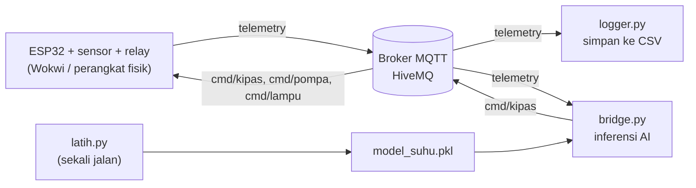

# mqtt-hydro-bitbyte

# 🌱 Smart Hydroponics AIoT

Sistem hidroponik cerdas untuk budidaya **selada**, dibangun dengan **ESP32**, **MQTT**, dan **machine learning**.
ESP32 memantau lingkungan dan mengendalikan aktuator secara otomatis, sementara sebuah model AI di sisi komputer
memprediksi suhu 30 menit ke depan dan menyalakan kipas **sebelum** suhu melewati batas.

> Proyek **Bit&Byte**, SIC Universitas Kuningan.
> Status: prototipe di simulator Wokwi. Model AI masih dilatih dengan **data sintetis** (lihat [Keterbatasan](#keterbatasan)).

---

## Daftar isi

- [Fitur](#fitur)
- [Arsitektur](#arsitektur)
- [Struktur repositori](#struktur-repositori)
- [Perangkat keras dan pin](#perangkat-keras-dan-pin)
- [Firmware ESP32](#firmware-esp32)
- [Topik MQTT](#topik-mqtt)
- [Komponen AI](#komponen-ai)
- [Cara menjalankan](#cara-menjalankan)
- [Pemecahan masalah](#pemecahan-masalah)
- [Keterbatasan](#keterbatasan)
- [Roadmap](#roadmap)
- [Tim](#tim)

---

## Fitur

**IoT (di ESP32)**
- Membaca suhu, kelembapan, cahaya (LDR), tinggi air (ultrasonik), pH, dan PPM.
- Mengendalikan 3 aktuator lewat relay: **kipas**, **pompa air**, dan **lampu tambahan**.
- Kontrol otomatis berbasis aturan (histeresis, jadwal lampu dengan RTC, pengaman sensor error).
- Tampilan LCD 20x4 dua halaman bergantian.
- Mengirim telemetry JSON lewat MQTT dan menerima perintah `ON` / `OFF` / `AUTO` dari jarak jauh.
- Koneksi non-blocking: sistem tetap berjalan walau WiFi atau broker putus.

**AI (di komputer)**
- Model **Random Forest** memprediksi suhu 30 menit ke depan.
- *Bridge* Python membaca telemetry, memprediksi, lalu mengirim perintah ke kipas lewat MQTT.
- Mode **shadow** (hanya prediksi) dan mode **kontrol** (benar-benar mengirim perintah).
- Aturan threshold di firmware tetap menjadi **pengaman**: kalau AI atau internet mati, sistem tetap bekerja.

---

## Arsitektur



Alur AIoT: **sensor → MQTT → model memprediksi → keputusan → MQTT → aktuator → umpan balik lewat telemetry.**
Firmware tidak perlu diubah untuk menambah AI, karena topik `cmd/` sudah menerima perintah dari luar.

| Komponen | Berjalan di | Terhubung ke Wokwi/MQTT? |
|---|---|---|
| Firmware ESP32 | Wokwi / ESP32 | Ya |
| `logger.py` | Komputer | Ya (lewat broker) |
| `latih.py` | Komputer | **Tidak** (offline, dijalankan sekali) |
| `bridge.py` | Komputer | Ya (lewat broker) |

---

## Struktur repositori

> Sesuaikan dengan struktur repo yang sebenarnya.

```
.
├── firmware/              # sketch ESP32 (.ino), diagram.json, libraries.txt (Wokwi)
├── logger.py              # merekam telemetry MQTT ke data_hidroponik.csv
├── latih.py               # membuat data sintetis + melatih model suhu
├── bridge.py              # jembatan AI: telemetry -> prediksi -> perintah kipas
├── data_hidroponik.csv    # hasil rekaman logger (dibuat otomatis)
├── data_sintetis.csv      # data latihan (dibuat latih.py)
├── model_suhu.pkl         # model terlatih (dibuat latih.py)
└── README.md
```

---

## Perangkat keras dan pin

Board: **ESP32 DevKit V1**. Hanya ADC1 (GPIO32-39) yang dipakai karena ADC2 tidak bisa dipakai saat WiFi aktif.

| Komponen | Pin ESP32 | Catatan |
|---|---|---|
| Relay 1, kipas | GPIO 18 | |
| Relay 2, pompa air | GPIO 19 | Pompa pengisi tandon |
| Relay 3, lampu | GPIO 23 | |
| HC-SR04 TRIG | GPIO 25 | |
| HC-SR04 ECHO | GPIO 26 | Lewat pembagi tegangan 1k/2k (echo 5V) |
| DHT22 | GPIO 27 | Suhu dan kelembapan |
| LDR | GPIO 34 | ADC1, input-only |
| Sensor pH | GPIO 35 | ADC1, input-only (potensiometer di Wokwi) |
| Sensor PPM | GPIO 32 | ADC1 (potensiometer di Wokwi) |
| LCD 20x4 I2C dan RTC DS1307 | SDA 21, SCL 22 | LCD alamat `0x27` |

Library Arduino: `DHT sensor library`, `Adafruit Unified Sensor`, `LiquidCrystal I2C`, `RTClib`, `Adafruit BusIO`, `PubSubClient`.

---

## Firmware ESP32

### Logika kontrol otomatis (rule-based)

| Aktuator | Nyala | Mati |
|---|---|---|
| **Kipas** | Suhu > 36 °C **atau** kelembapan > 78 % | Suhu ≤ 32 °C **dan** kelembapan ≤ 65 % |
| **Pompa** | Jarak air ≥ 200 cm (air rendah) | Jarak air ≤ 180 cm. Selalu mati jika sensor ultrasonik error |
| **Lampu** | Cahaya ≤ 100 lux **atau** dalam jadwal 07:30-08:00 / 16:00-17:30 | Di luar kondisi itu |

Batas nutrisi selada: pH **5.5-6.5**, PPM **560-840**.

### Mode kontrol dan override

Setiap aktuator punya mode `AUTO` (aturan di atas), `ON`, atau `OFF` (override manual lewat MQTT).
Override **kedaluwarsa otomatis setelah 15 menit** dan kembali ke `AUTO`. Jadi kalau bridge mati
setelah mengirim `ON`, kipas tidak menyala selamanya.

### Konfigurasi yang perlu disesuaikan

| Konstanta | Fungsi |
|---|---|
| `WIFI_SSID`, `WIFI_PASS`, `WIFI_CHANNEL` | Wokwi: `Wokwi-GUEST`, kosong, channel `6`. Perangkat asli: WiFi sendiri dan channel `0` |
| `MQTT_HOST`, `MQTT_PORT` | Default `broker.hivemq.com:1883` (broker publik) |
| `ID_PERANGKAT` | Bagian dari nama topik. **Ganti dengan nilai unik dan sulit ditebak** |
| `RELAY_AKTIF_HIGH` | Ubah ke `false` jika modul relay aktif-LOW |
| `mqtt.setKeepAlive(60)` | Wajib di Wokwi, karena simulasi lebih lambat dari waktu nyata |

---

## Topik MQTT

Prefix: `hidroponik/<ID_PERANGKAT>/` (default: `hidroponik/bitbyte_uniku/`)

| Topik | Arah | Isi |
|---|---|---|
| `telemetry` | ESP32 → broker | JSON data sensor dan status aktuator, tiap 5 detik |
| `status` | ESP32 → broker (retained) | `online` / `offline` (Last Will) |
| `cmd/kipas` | broker → ESP32 | `ON` / `OFF` / `AUTO` |
| `cmd/pompa` | broker → ESP32 | `ON` / `OFF` / `AUTO` |
| `cmd/lampu` | broker → ESP32 | `ON` / `OFF` / `AUTO` |

Contoh payload `telemetry`:

```json
{
  "suhu": 35.8, "hum": 52.0, "lux": 22930, "jarak": 177.0, "ph": 6.30, "ppm": 700,
  "status_air": "Cukup", "status_ph": "Normal", "status_ppm": "Normal",
  "kipas": 0, "pompa": 0, "lampu": 0,
  "mode_kipas": "AUTO", "mode_pompa": "AUTO", "mode_lampu": "AUTO",
  "waktu": "2026-10-28 14:02:11", "rssi": -52, "uptime": 842
}
```

`suhu`, `hum`, dan `jarak` bernilai `null` jika sensornya error. `uptime` dalam detik sejak ESP32 menyala.

---

## Komponen AI

### Tujuan

Memprediksi **suhu 30 menit ke depan** agar kipas bisa dinyalakan lebih awal, bukan menunggu suhu melewati 36 °C.

### Model

- Algoritma: `RandomForestRegressor` (scikit-learn).
- Fitur: `suhu`, `hum`, `lux`, `kipas`, `tren5` (selisih suhu sekarang dengan 5 menit lalu).
- Target: suhu 30 menit kemudian.
- Data latihan: 60 hari data **sintetis** per menit (pola suhu harian, cuaca cerah/mendung, kipas dengan histeresis yang sama seperti firmware), dibuat oleh `latih.py`.
- Validasi: pembagian **berurutan** 80/20 (bukan acak), dibandingkan dengan baseline "suhu tetap".

### Hasil evaluasi (data sintetis, seed 42)

| Metrik | Baseline (suhu tetap) | Random Forest |
|---|---|---|
| Rata-rata error prediksi 30 menit | 0.72 °C | **0.41 °C** |
| Kejadian ≥ 34 °C yang terdeteksi | 2364 dari 2960 | **2661 dari 2960** |

Model menghasilkan 446 alarm palsu. Pada kipas, alarm palsu hanya berarti kipas menyala sedikit lebih awal.
Angka bisa sedikit berbeda antar versi library.

> Angka ini membuktikan **pipeline** berfungsi, bukan akurasi di dunia nyata, karena modelnya belajar dari data simulasi.

### Cara bridge mengambil keputusan

| Kondisi | Aksi |
|---|---|
| Prediksi ≥ **34 °C** dan `mode_kipas = AUTO` | Kirim `ON` ke `cmd/kipas` |
| Kipas sedang di-ON-kan AI dan prediksi < **33 °C** | Kirim `AUTO` (kembali ke aturan firmware) |
| Kipas masih di-ON-kan AI | Kirim ulang `ON` tiap 300 detik (waktu ESP32), karena override firmware kedaluwarsa 15 menit |
| Mode kipas diubah pihak lain (manual/timeout) | AI melepas kendali |

Bridge memakai `uptime` dari telemetry sebagai jam, bukan jam komputer, supaya benar walau Wokwi berjalan lambat.
**Pompa tidak dikendalikan AI** (risiko meluap atau kering lebih besar), hanya kipas.

Pengaturan di bagian atas `bridge.py`:

| Variabel | Default | Arti |
|---|---|---|
| `KONTROL` | `False` | `False` = shadow (hanya prediksi). `True` = benar-benar mengirim perintah |
| `BATAS_PRA_AKTIF` / `BATAS_LEPAS` | `34.0` / `33.0` | Ambang menyalakan dan melepas kipas |
| `JENDELA_TREN` | `300` | Jendela tren dalam detik. Model dilatih dengan 5 menit. Nilai `30` hanya untuk demo di Wokwi dengan slider diam |

---

## Cara menjalankan

### 1. Siapkan Python (3.10+)

```bash
python -m venv venv
source venv/bin/activate          # Windows: venv\Scripts\activate
pip install paho-mqtt pandas numpy scikit-learn joblib
```

### 2. Jalankan simulasi / perangkat

1. Buka proyek di Wokwi (atau upload firmware ke ESP32).
2. Pastikan `ID_PERANGKAT` di firmware sama dengan `BASE` di `logger.py` dan `bridge.py`.
3. Jalankan simulasi sampai Serial Monitor menampilkan `MQTT=1` dan stabil.

Uji cepat tanpa Python: buka [HiveMQ WebSocket Client](https://www.hivemq.com/demos/websocket-client/),
subscribe ke `hidroponik/<ID_PERANGKAT>/#`, lalu pastikan JSON telemetry masuk tiap beberapa detik.

### 3. Rekam data (opsional)

```bash
python logger.py        # hentikan dengan Ctrl+C
```

Hasilnya ditambahkan ke `data_hidroponik.csv`.

### 4. Latih model (sekali saja)

```bash
python latih.py
```

Menghasilkan `data_sintetis.csv` dan `model_suhu.pkl`, serta mencetak perbandingan model vs baseline.

### 5. Jalankan bridge AI

```bash
python bridge.py
```

Mulai dari mode shadow (`KONTROL = False`). Output contoh:

```
suhu=35.8 hum=52 lux=22930 kipas=0 tren5=+0.00 -> prediksi 30 mnt: 34.5 C | mode_kipas=AUTO
   AI: suhu diprediksi naik -> nyalakan kipas lebih awal
   [SHADOW] seharusnya kirim: cmd/kipas = ON  (belum dikirim)
```

Jika prediksi terlihat masuk akal, ubah `KONTROL = True` dan jalankan ulang. Relay kipas akan menyala
saat suhu masih di bawah 36 °C.

### Skenario uji di Wokwi

Atur slider **sebelum** menjalankan bridge, lalu jangan digeser selama pengujian (perubahan mendadak membuat tren tidak wajar).

| Atur | Hasil yang diharapkan |
|---|---|
| Suhu 35, lux sekitar 25.000 | Prediksi ±34.5-35 °C, AI menyalakan kipas |
| Suhu 30, lux sekitar 25.000 | Prediksi ±31 °C, tidak ada aksi |
| Suhu 29, lux sekitar 500 | Prediksi ±28 °C, tidak ada aksi |
| Turunkan suhu ke 29 setelah AI menyalakan kipas | AI mengirim `AUTO` |

---

## Pemecahan masalah

| Gejala | Penyebab dan solusi |
|---|---|
| `MQTT=0` terus | Cek `WiFi=` di Serial Monitor. Di Wokwi pakai `Wokwi-GUEST`, password kosong, channel 6. Cek juga baris `[MQTT] Gagal, rc=...` |
| MQTT putus-sambung di Wokwi | Keepalive bawaan (15 detik) terlalu pendek untuk simulasi yang lambat. Pastikan `mqtt.setKeepAlive(60)` ada di `setup()` |
| Bridge lama menampilkan "Mengumpulkan riwayat" | Bridge butuh `JENDELA_TREN` detik waktu ESP32, dan Wokwi berjalan ±4x lebih lambat dari waktu nyata. Untuk demo dengan slider diam, set `JENDELA_TREN = 30` |
| Prediksi aneh setelah slider digeser | Normal. Tren sesaat tidak wajar. Atur slider dulu, lalu restart bridge |
| `pH=0` dan `PPM=0` | Potensiometer di Wokwi masih di nol. Set ±45 % (pH ≈ 6.3) dan ±47 % (≈ 700 ppm) |
| Error saat memuat `model_suhu.pkl` | Versi scikit-learn berbeda dari saat melatih. Jalankan ulang `latih.py` di lingkungan yang sama |

---

## Keterbatasan

Bagian ini sengaja ditulis terus terang agar tim dan penilai tidak salah menafsirkan hasilnya.

- **Model dilatih dengan data sintetis**, bukan data nyata. Evaluasinya membuktikan alur AIoT berfungsi, bukan akurasi di kebun sungguhan. Rencana: latih ulang dengan data prototipe fisik.
- **Hanya akurat di rentang suhu sekitar 20-36 °C.** Random Forest tidak bisa mengekstrapolasi. Di luar rentang itu, tugas pengamanan dipegang aturan threshold firmware.
- **Efek kipas pada prediksi masih lemah**, karena di data sintetis kipas hanya menyala ±4 % waktu.
- **Broker HiveMQ publik tidak punya autentikasi.** Siapa pun yang tahu nama topik bisa membaca data dan mengirim perintah. Untuk perangkat sungguhan, pakai broker pribadi dengan login dan TLS.
- **pH dan PPM masih konversi linear mentah** (0-14 dan 0-1500). Sensor asli perlu kalibrasi, dan PPM/TDS sebaiknya dikompensasi suhu.
- Data dari Wokwi (slider manual) **tidak cocok untuk melatih model**, karena nilainya melompat dan tidak mengikuti pola waktu.

---

## Roadmap

- [x] Firmware IoT dengan kontrol otomatis dan MQTT
- [x] Logger data ke CSV
- [x] Model prediksi suhu dan evaluasi terhadap baseline
- [x] Bridge AI (shadow dan kontrol)
- [ ] Dashboard web (data real-time, prediksi AI, tombol kontrol)
- [ ] Deteksi anomali (pH drift, sensor macet) dan notifikasi Telegram
- [ ] Prototipe fisik dan pengumpulan data nyata
- [ ] Latih ulang model dengan data nyata
- [ ] Broker MQTT pribadi dengan autentikasi dan TLS
- [ ] Kalibrasi sensor pH dan PPM, serta kompensasi suhu
- [ ] Computer vision untuk kesehatan daun selada (ESP32-CAM)

---

## Tim

**Bit&Byte**, SIC Universitas Kuningan
